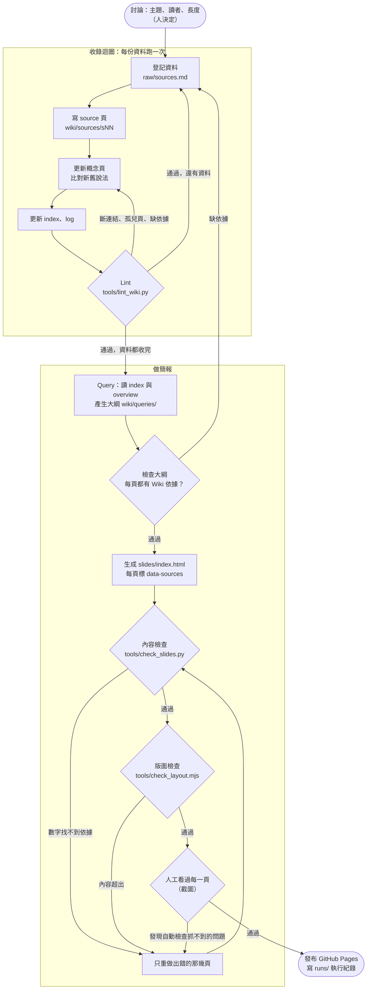

# Loop／Graph 設計

這個專案的流程分成兩段：**收錄（Ingest loop）** 把資料變成 Wiki；**做簡報（Slides graph）** 從 Wiki 產生成品。
兩段都有「檢查不過就退回上一步」的迴圈，退回的範圍越小越好。

## 哪些步驟會重複執行
| 步驟 | 什麼時候重複 | 為什麼 |
|---|---|---|
| 收錄迴圈（登記 → source 頁 → 概念頁 → index/log → Lint） | 每份資料跑一次，這次跑了 8 次 | 一份資料通常會動到好幾個概念頁，逐份收錄才看得出新舊說法有沒有矛盾 |
| Lint | 每次收錄後都跑；不通過就修到通過 | 頁面越多，斷連結與孤兒頁越容易出現 |
| 內容檢查、版面檢查 | 每次重做簡報頁面後都重跑 | 改一頁可能讓另一個數字或版面出錯 |
| 只重做出錯的頁 | 檢查不通過時 | 整份重生成會把已經正確的頁面也改掉 |

## 哪些地方需要檢查或重新生成
| 檢查點 | 檢查什麼 | 不通過時 |
|---|---|---|
| Lint | front matter、依據的 source 存在、連結、index 收錄、孤兒頁 | 回到「更新概念頁」 |
| 檢查大綱 | 每一頁簡報都有對應的 Wiki 頁；推論要照樣標成推測 | 回到收錄補資料，而不是硬寫 |
| 內容檢查 | 每頁的 data-sources 存在；頁面上每個數字都能在引用的 Wiki 頁找到 | 只重做該頁，或補正確的依據 |
| 版面檢查 | 1280×720 與手機寬度下內容不超出 | 只重做該頁 |
| 人工檢查 | 自動檢查抓不到的錯：編造的例子、看起來不對的切法 | 只重做該頁 |

## 為什麼這樣設計
- **先討論、後生成**：讀者是誰會決定 Wiki 要寫到多深，所以放在最前面，而且由人決定。
- **Wiki 是唯一的知識來源**：簡報只能引用 Wiki，所以「簡報有沒有亂講」可以變成機器能檢查的問題（數字對不對得上）。
- **檢查越早越便宜**：Lint 在每份資料收錄後就跑，錯誤只會影響剛改的幾頁；等到做簡報才發現，就要回頭追好幾層。
- **自動檢查不是全部**：數字檢查只能證明「有依據」，不能證明「例子不是編的」，所以最後保留人工看圖。
